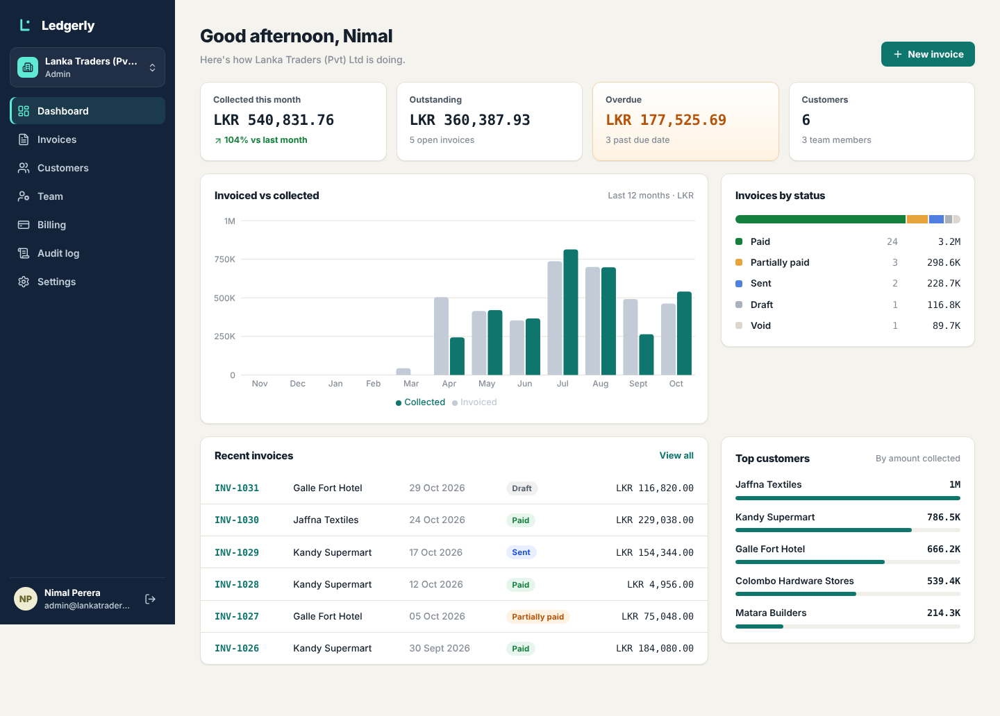
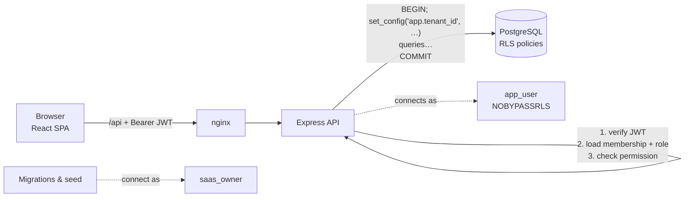
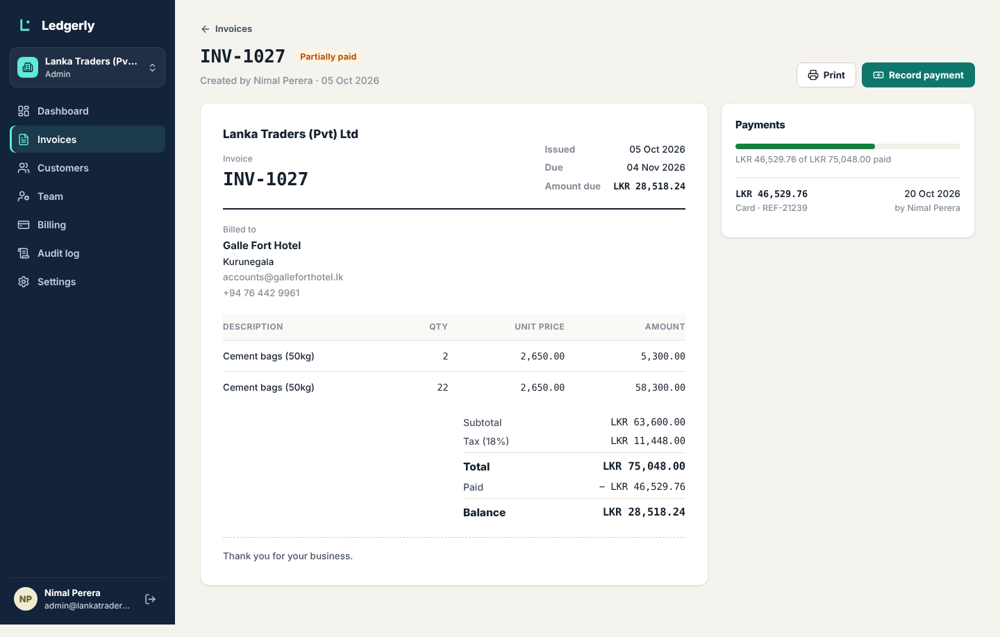
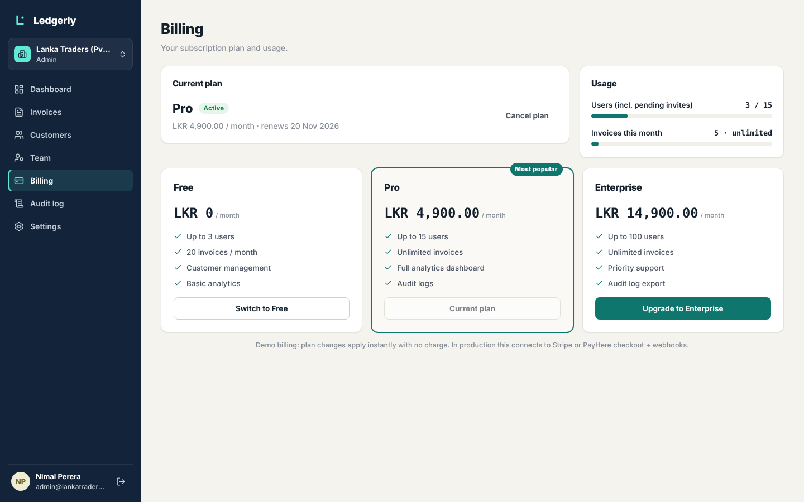
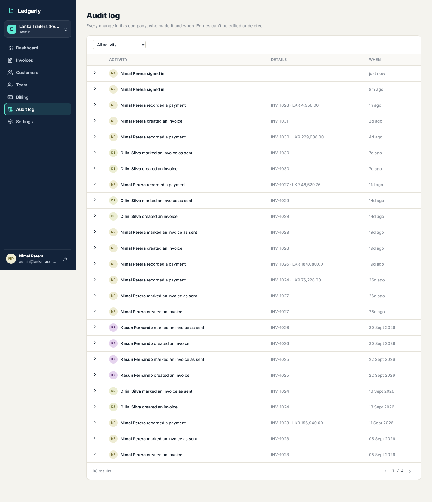

# Ledgerly — Multi-Tenant SaaS Business Management Platform

A full-stack SaaS platform where **many companies share one application and one database, but can never see each other's data**. Each company manages its team, customers, invoices and payments, with subscription plans, an append-only audit log and an analytics dashboard.

**Tech:** React 19 · TypeScript · Node.js (Express 5) · PostgreSQL 16 · Prisma 7 · Docker · Vitest



---

## Highlights

| Area | What's implemented |
|---|---|
| **Tenant isolation** | Shared schema + `tenantId`, enforced by **PostgreSQL Row-Level Security**, not just application code |
| **RBAC** | Admin / Manager / Employee mapped to 14 granular permissions; checked on every API route; role changes apply instantly |
| **Auth** | Short-lived JWT access token + httpOnly **rotating refresh token** with reuse detection; bcrypt; rate-limited login |
| **Multi-company users** | One login can belong to several companies with a different role in each, plus a company switcher |
| **Team invitations** | Invite by link with a role; plan seat limits enforced |
| **Subscriptions** | Free / Pro / Enterprise with user and monthly-invoice limits, upgrade, downgrade checks, cancel at period end |
| **Invoices & payments** | Per-company sequential numbering, line items, VAT, draft → sent → partially paid → paid / void, partial payments, overpayment protection, print view |
| **Audit log** | Every change recorded in the *same transaction* as the change; the app's DB role **cannot UPDATE or DELETE** audit rows |
| **Analytics** | Monthly invoiced vs collected, outstanding & overdue, status breakdown, top customers |
| **Quality** | 30 automated tests (incl. cross-tenant attack tests), strict TypeScript, CI on GitHub Actions, Docker Compose |

---

## Architecture



### How tenant isolation works

1. **Two database roles.** Migrations run as the schema owner. The running API connects as `app_user`, which is *not* a superuser and does *not* have `BYPASSRLS`.
2. **Row-Level Security policies** on every tenant-owned table:
   ```sql
   CREATE POLICY tenant_isolation ON "Invoice"
     USING ("tenantId" = app_current_tenant())
     WITH CHECK ("tenantId" = app_current_tenant());
   ```
3. **Per-request context.** Every authenticated request runs inside a transaction that first calls `set_config('app.tenant_id', <tenant>, true)`. The `true` makes it *transaction-local*, so a pooled connection can never carry one company's context into another request. ([`src/lib/prisma.ts`](backend/src/lib/prisma.ts))
4. **Defence in depth.** The code still filters by `tenantId` explicitly. If a developer forgets that filter, RLS still returns only the current company's rows; if RLS were misconfigured, the explicit filter still applies.

The tests prove this: with tenant A's context, raw `SELECT * FROM "Invoice"` with **no WHERE clause** returns only A's invoices, and inserting a row for tenant B fails with a row-level security error ([`tests/tenant-isolation.test.ts`](backend/tests/tenant-isolation.test.ts)).

### Roles & permissions

| Permission | Admin | Manager | Employee |
|---|:-:|:-:|:-:|
| View / create customers & invoices | ✅ | ✅ | ✅ |
| Delete customers, void / delete invoices | ✅ | ✅ | — |
| Record payments | ✅ | ✅ | — |
| Analytics dashboard, audit log | ✅ | ✅ | — |
| View billing | ✅ | ✅ | — |
| Invite / remove members, change roles | ✅ | — | — |
| Change subscription, company settings | ✅ | — | — |

Routes check **permissions**, not role names (`requirePermission('payments:create')`), so roles can change without touching route code. The membership is re-read from the database on every request, so a removed member is locked out immediately, not when their token expires. A company can never lose its last admin.

### Data model

`Tenant` · `User` · `Membership` (user ↔ tenant + role) · `Invitation` · `Plan` · `Subscription` · `Customer` · `Invoice` · `InvoiceItem` · `Payment` · `AuditLog` · `RefreshToken`

Money is stored as **integer cents** to avoid floating-point rounding errors. See [`prisma/schema.prisma`](backend/prisma/schema.prisma).

---

## Quick start (Docker)

```bash
git clone https://github.com/Lochana720/saas-platform.git
cd saas-platform
docker compose up --build
```

Open **http://localhost:8080**. Migrations and demo data are applied automatically.

### Demo accounts (password `Password123!`)

| Email | What you'll see |
|---|---|
| `admin@lankatraders.lk` | Admin of Lanka Traders (Pro plan): everything |
| `manager@demo.lk` | Manager at Lanka Traders **and** Employee at Ceylon Tech; try the company switcher |
| `staff@lankatraders.lk` | Employee: no dashboard, billing, audit log or team management |
| `admin@ceylontech.lk` | Admin of Ceylon Tech (Free plan); try inviting a 4th user to hit the plan limit |

---

## Local development (without Docker)

Requirements: Node.js 20.19+ and PostgreSQL 16.

```bash
# 1. Database and the two roles
psql -U postgres <<'SQL'
CREATE ROLE saas_owner LOGIN BYPASSRLS PASSWORD 'owner_password';  -- migrations & seed
CREATE ROLE app_user LOGIN NOSUPERUSER NOBYPASSRLS PASSWORD 'app_password'; -- the API
CREATE DATABASE saas OWNER saas_owner;
SQL

# 2. API
cd backend
cp .env.example .env
npm install
npx prisma generate
npx prisma migrate deploy
npx prisma db seed
npm run dev             # http://localhost:4000

# 3. Web app (new terminal)
cd frontend
npm install
npm run dev             # http://localhost:5173
```

> The owner role needs `BYPASSRLS` because the tables use `FORCE ROW LEVEL SECURITY` (even the table owner is filtered), and the seed writes rows for several companies. The API role never gets it.

### Tests

```bash
cd backend
npm test
```

```
✓ tests/tenant-isolation.test.ts   (11)  API + raw-SQL cross-tenant attacks, append-only audit log
✓ tests/rbac.test.ts               (10)  permissions per role, instant role changes, last-admin guard
✓ tests/billing-invoices.test.ts    (9)  totals, payment lifecycle, plan limits, refresh-token reuse
Tests  30 passed
```

The tests run against a real PostgreSQL database (RLS can't be tested with mocks).

---

## API overview

All routes are under `/api`. Everything except `/auth/*` requires `Authorization: Bearer <token>`.

| Method & path | Permission | Purpose |
|---|---|---|
| `POST /auth/register` | public | Create company + admin user |
| `POST /auth/login` · `/auth/refresh` · `/auth/logout` | public | Session management |
| `POST /auth/switch-tenant` | member | Move session to another company |
| `GET /auth/invitations/:token` · `POST …/accept` | public | Join a company by invite link |
| `GET /members` | `members:read` | Members (+ pending invites for admins) |
| `POST /members/invitations` · `PATCH /members/:id` · `DELETE /members/:id` | `members:manage` | Invite, change role, remove |
| `GET/POST/PATCH/DELETE /customers` | `customers:*` | Customer CRUD with search & paging |
| `GET/POST/PUT/DELETE /invoices` | `invoices:*` | Invoices with status filters (incl. overdue) |
| `POST /invoices/:id/send` · `/void` | `invoices:write` / `invoices:delete` | Status changes |
| `POST /invoices/:id/payments` | `payments:create` | Record a (partial) payment |
| `GET /billing` · `POST /billing/subscription` · `POST /billing/subscription/cancel` | `billing:*` | Plans, usage, change plan |
| `GET /analytics/summary` | `analytics:read` | Dashboard data |
| `GET /audit-logs` | `audit:read` | Filterable, paginated activity log |
| `GET/PATCH /tenant` | `tenant:manage` | Company settings |

Errors use one shape: `{ "error": { "code": "PLAN_LIMIT_REACHED", "message": "…", "details": {…} } }`.

---

## Security checklist

- PostgreSQL RLS with a non-bypass application role; context is transaction-local
- Audit log is append-only at the database permission level (`REVOKE UPDATE, DELETE`)
- Refresh tokens: random, stored only as SHA-256 hashes, single-use, reuse revokes all sessions
- Refresh token in an `httpOnly`, `SameSite=Lax` cookie scoped to `/api/auth`; access token only in memory
- bcrypt (cost 12); constant-time login response for unknown emails (no user enumeration)
- Rate limiting on login, register and invite acceptance
- Zod validation on every input; helmet security headers; 1 MB body limit
- Row lock (`SELECT … FOR UPDATE`) prevents concurrent payments from overpaying an invoice
- Advisory lock gives gap-free per-company invoice numbers under concurrency

## Project structure

```
backend/
  prisma/schema.prisma          data model
  prisma/migrations/            SQL incl. RLS policies (…_row_level_security)
  prisma/seed.ts                plans + 2 demo companies
  src/lib/prisma.ts             withContext(): sets tenant context per transaction
  src/lib/permissions.ts        role → permission map
  src/middleware/auth.ts        JWT + live membership check + requirePermission()
  src/routes/*.routes.ts        auth, members, customers, invoices, billing, analytics, audit, tenant
  src/services/subscription.ts  plan limits & period handling
  tests/                        Vitest + Supertest against real Postgres
frontend/
  src/auth/AuthContext.tsx      session, silent refresh, company switching
  src/lib/api.ts                fetch wrapper with automatic token refresh
  src/pages/                    dashboard, invoices, customers, team, billing, audit log, settings
docker-compose.yml              db + api + web (nginx)
```

## Going further

- **Real payments:** replace the mock in `billing.routes.ts` with Stripe or PayHere checkout and apply plan changes from their webhook
- **Email:** send invitation links and invoices (Resend, SES)
- **PDF invoices** generated on the server
- **Background jobs** for overdue reminders
- **Per-tenant data export** (GDPR-style)

## Screenshots

| Invoice | Billing | Audit log |
|---|---|---|
|  |  |  |

---

Built by [Lochana](https://github.com/Lochana720) as a portfolio project.
